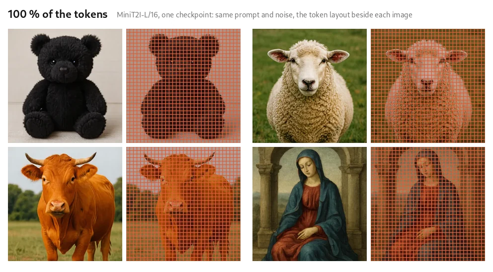

<p align="center">
  <picture>
    <source media="(prefers-color-scheme: dark)" srcset="docs/assets/brand/budgetpix_dark.svg">
    
  </picture>
</p>

<p align="center">
  🌐 <a href="https://budgetany.github.io/budgetpix/"><b>Project page</b></a> &nbsp;|&nbsp;
  📄 <a href="https://arxiv.org/abs/2610.12307">Paper</a> &nbsp;|&nbsp;
  🤗 <a href="https://huggingface.co/BudgetAny">Models</a> &nbsp;|&nbsp;
  🧩 <a href="https://budgetany.github.io/">BudgetAny</a>: BudgetPix · <a href="https://github.com/BudgetAny/Budget3D">Budget3D</a> · <a href="https://github.com/BudgetAny/BudgetLatent">BudgetLatent</a>
</p>

-----

**BudgetPix** makes pixel-space diffusion transformers compute-adaptive: one checkpoint runs at any token budget. An
entropy-guided quadtree merges flat regions into coarser tokens, the backbone runs on the shorter sequence, and a small
token-local refiner restores the detail inside every merged token. The budget is a number you pass at inference.

> **Unofficial, open-source implementation**, taken from [budgetpix/BudgetPix-public](https://github.com/budgetpix/BudgetPix-public): a public reimplementation of BudgetPix: compute-adaptive tokenization for pixel-space image diffusion (JiT, MiniT2I, PixelDiT, pMF).
> This repository is part of [BudgetAny](https://budgetany.github.io/) and is based on the method of the
> [BudgetPix paper](https://arxiv.org/abs/2610.12307) (Kara et al., 2026). It is not an official release. Thanks to the
> BudgetPix authors for the method.

<p align="center"></p>
<p align="center"><em>One checkpoint, any budget: the same prompt and noise at decreasing token budgets.</em></p>

## 🔥 News

- **Nov 2026:** BudgetPix joins [BudgetAny](https://budgetany.github.io/), next to [Budget3D](https://github.com/BudgetAny/Budget3D) and [BudgetLatent](https://github.com/BudgetAny/BudgetLatent).
- **Oct 2026:** Code and checkpoints for JiT, pixel MeanFlow, MiniT2I and PixelDiT.

## 📦 Models

| Model | Base model | Task | Weights |
|---|---|---|---|
| BudgetPix-JiT | [JiT](https://github.com/LTH14/JiT) | Class-conditional ImageNet | 🤗 [BudgetAny/BudgetPix-JiT](https://huggingface.co/BudgetAny/BudgetPix-JiT) |
| BudgetPix-pMF | [pixel MeanFlow](https://github.com/Lyy-iiis/pMF) | One-step class-conditional ImageNet | 🤗 [BudgetAny/BudgetPix-pMF](https://huggingface.co/BudgetAny/BudgetPix-pMF) |
| BudgetPix-MiniT2I | [MiniT2I](https://huggingface.co/MiniT2I/MiniT2I) | Text-to-image | 🤗 [BudgetAny/BudgetPix-MiniT2I](https://huggingface.co/BudgetAny/BudgetPix-MiniT2I) |
| BudgetPix-PixelDiT | [PixelDiT](https://huggingface.co/nvidia/PixelDiT-1300M-1024px) | Text-to-image (non-commercial) | 🤗 [BudgetAny/BudgetPix-PixelDiT](https://huggingface.co/BudgetAny/BudgetPix-PixelDiT) |

## 🚀 Usage

#### Installation

Python 3.10+ and a CUDA GPU.

```bash
git clone https://github.com/BudgetAny/BudgetPix && cd BudgetPix
pip install -r requirements.txt
pip install flash-attn --no-build-isolation      # optional: varlen attention kernels for JiT
# the pMF, MiniT2I and PixelDiT models are imported from their official code
git clone -b torch https://github.com/Lyy-iiis/pMF upstream/pMF && export PMF_ROOT=$PWD/upstream/pMF
git clone https://github.com/Hope7Happiness/minit2i-torch upstream/minit2i-torch && export MINIT2I_ROOT=$PWD/upstream/minit2i-torch
git clone https://github.com/NVlabs/PixelDiT upstream/PixelDiT && export PIXELDIT_ROOT=$PWD/upstream/PixelDiT
```

#### Download the weights

```bash
hf download BudgetAny/BudgetPix-MiniT2I --local-dir checkpoints    # one model family
python scripts/download_checkpoints.py --all                        # or all of them, checked against checkpoints/SHA256SUMS
```

#### Sample

`--budget` is the number of tokens per image (here half of the full grid); without it, the model runs on the full grid.

```bash
cd jit           # JiT: class-conditional ImageNet, with the token layout
python sample.py --ckpt ../checkpoints/budgetpix_jit_l32_512.pth --classes 207,88,417,933 --budget 128 --overlay
cd ../pmf        # pixel MeanFlow: one-step ImageNet
python sample.py --ckpt ../checkpoints/budgetpix_pmf_l16_256.pt --classes 207,88,417,933 --budget 128 --overlay
cd ../minit2i    # MiniT2I: text-to-image
python sample.py --ckpt ../checkpoints/budgetpix_minit2i_l_512.pt --prompts "a corgi in a spacesuit" --budget 512 --cfg 6.0
cd ../pixeldit   # PixelDiT: text-to-image
python sample.py --ckpt ../checkpoints/budgetpix_pixeldit_1024.pt --prompts "a red fox in a snowy forest" --budget 2048
```

## 📚 Citation

<p align="center">
  <a href="https://arxiv.org/abs/2610.12307"><b>BudgetPix: Compute-Adaptive Tokenization for Pixel-Space Image Diffusion</b></a><br>
  <a href="https://karaozgur.com/">Ozgur Kara</a><sup>1,†</sup>, <a href="https://scholar.google.com/citations?user=Dv5gB7cAAAAJ&hl=en">Yujia Chen</a><sup>2</sup>, <a href="https://scholar.google.com/citations?user=ve9A9rMAAAAJ&hl=en">Daniel Watson</a><sup>2</sup>, <a href="https://scholar.google.com/citations?user=5H0arvkAAAAJ&hl=en">David Forsyth</a><sup>1</sup>, <a href="https://scholar.google.com/citations?user=8kA3eDwAAAAJ&hl=en">James Matthew Rehg</a><sup>1</sup>, <a href="https://scholar.google.com/citations?user=R-OrlSgAAAAJ&hl=en">Wen-Sheng Chu</a><sup>2,‡</sup>, <a href="https://scholar.google.com/citations?user=3TVbh8QAAAAJ&hl=en">Du Tran</a><sup>2,‡</sup><br>
  <sup>1</sup>University of Illinois Urbana-Champaign &nbsp; <sup>2</sup>Google<br>
  <sup>†</sup>Work done during an internship at Google. &nbsp; <sup>‡</sup>Joint last authors.
</p>

```bibtex
@article{kara2026budgetpix,
  title={BudgetPix: Compute-Adaptive Tokenization for Pixel-Space Image Diffusion},
  author={Ozgur Kara and Yujia Chen and Daniel Watson and David Forsyth and James Matthew Rehg and Wen-Sheng Chu and Du Tran},
  journal={arXiv preprint arXiv:2610.12307},
  year={2026}
}
```

## 📄 License

The code is released under the MIT License ([`LICENSE`](LICENSE)), like the vendored JiT modules and the imported pMF and
MiniT2I code. The JiT, pMF and MiniT2I checkpoints derive from MIT-licensed weights. The PixelDiT checkpoint derives from
NVIDIA's PixelDiT weights and is released under the same NVIDIA License (NSCLv1), which permits non-commercial use only.

## 🙏 Acknowledgements

This implementation builds on [JiT](https://github.com/LTH14/JiT), [pixel MeanFlow](https://github.com/Lyy-iiis/pMF),
[MiniT2I](https://github.com/Hope7Happiness/minit2i-torch) and [PixelDiT](https://github.com/NVlabs/PixelDiT), whose released
models are its backbones. The entropy-based layout follows [APT](https://github.com/rccchoudhury/apt), and FID and IS are
computed with the [LTH14 fork of torch-fidelity](https://github.com/LTH14/torch-fidelity).
